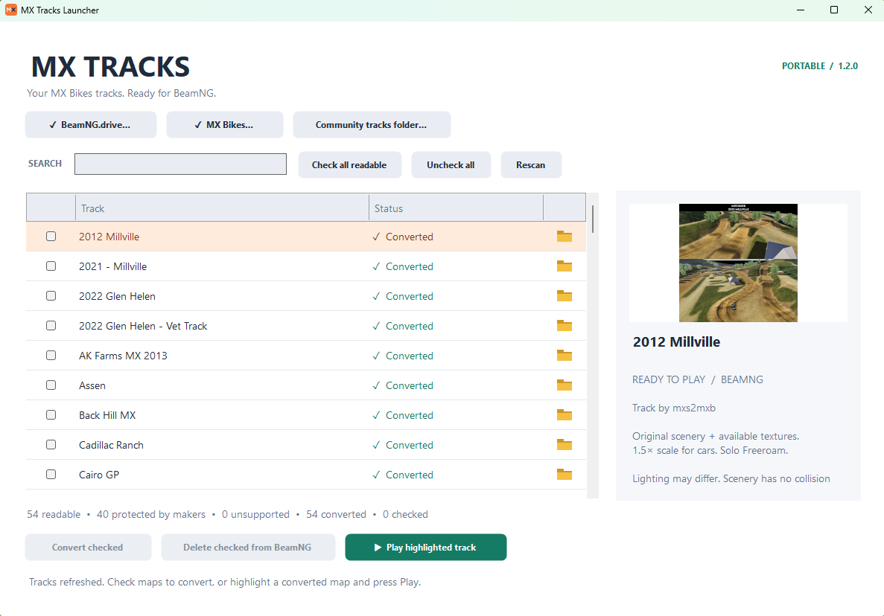

# MX Tracks Launcher

**Your MX Bikes tracks, ready for BeamNG.drive.**

MX Tracks Launcher turns your MX Bikes tracks into BeamNG.drive maps, so you can drive any BeamNG car or truck on real motocross tracks, over the real jumps, whoops and berms, with BeamNG's vehicle and crash physics.

## Features

- **Pick your tracks:** it lists every MX Bikes track on your PC with a preview picture. Tick the ones you want and press Convert. Converted tracks are listed first.
- **Close to the real thing:** it brings over each track's own layout, jumps, dirt and grass textures, trees, fences and buildings from your own MX Bikes copy.
- **Play in one click:** highlight a converted track and press Play. BeamNG opens straight onto it.
- **Tidy:** the folder icon shows where each track lives, and Delete removes a converted track from BeamNG without touching the original.
- **Honest about limits:** tracks their makers encrypted are greyed out and marked *Protected by maker*. Scenery has no collision yet, and the lighting differs from MX Bikes.
- **Easy to share:** it's one small ZIP with no game files inside. Friends just need both games.

## Download

Get **MXTracksLauncher-1.2.0.zip** from the [Releases page](../../releases/latest).

1. Extract the **whole** zip to a folder.
2. Open `MXTracksLauncher.exe`. Keep the `beamng` folder next to it.

You don't need an installer, an account, or any paid service.

## Requirements

- Windows 10 or 11 (64-bit)
- .NET Framework 4.8 (normally built into Windows)
- Your own installed copies of **BeamNG.drive** and **MX Bikes**

Steam libraries on any drive and standalone (non-Steam) PiBoSo installs are detected automatically. You can also point the launcher at a different game install or a custom MX Bikes mods/community tracks folder.

**No game content is included.** The launcher only reads your own files.

## How to use

1. **Convert:** tick the readable tracks you want, then click **Convert checked**. Maps you converted before stay installed, and re-converting a track only replaces that track.
2. **Play:** highlight a converted track and click **Play highlighted track**. BeamNG starts on that map.
3. **Open source folder:** the folder icon next to a track opens its original location.
4. **Remove:** tick converted tracks and click **Delete checked from BeamNG**. This removes them from BeamNG's map list only. **Your original MX Bikes tracks are never deleted.**

Converted tracks are listed first, sorted alphabetically within each group.

### Track statuses

| Status | Meaning |
| --- | --- |
| ✓ Converted | Ready to play in BeamNG |
| Readable | Can be converted |
| Protected by maker | The track creator encrypted it so only MX Bikes can open it (Farm14 is one example). The launcher respects this and never unlocks protected tracks. If the maker releases an unprotected version, it will show up as ready to convert. |
| Cannot convert | A readable package in a layout the launcher doesn't support yet |

## Good to know

- **Close BeamNG yourself** before converting, deleting, or launching another track. The launcher never closes any game.
- Updates are written to a temporary file first and only replace the generated map archive once they succeed. This needs enough free space for a second copy of that archive while it works. Temporary files are cleaned up afterwards.
- Maps run in **Solo Freeroam** at **1.5× scale** so they suit cars.
- Original scenery and recognisable ground textures are imported where supported. Fallback colours are used otherwise.
- Lighting, ground blending, and texture tiling look different from MX Bikes.
- Scenery is visual-only with no collision. The terrain itself is drivable and has collision.
- There's no BeamMP (multiplayer) server setup.

## What's in this repo

| Path | Purpose |
| --- | --- |
| `beamng/lua/ge/extensions/mxbikesTracks.lua` | In-game BeamNG extension. It shows the track name when a converted map loads and runs the automated load/drive self-test. |
| `beamng/scripts/mxbikes_tracks/modScript.lua` | Loads the extension when BeamNG starts |
| `docs/screenshot.png` | Screenshot used above |

The compiled launcher (`MXTracksLauncher.exe`) is published with each release.

## Credits and permissions

- **BeamNG.drive:** BeamNG GmbH
- **MX Bikes:** PiBoSo
- **Community tracks:** their original creators

Your own game copies provide all of the original content. The converter and integration were developed with AI assistance, using Windows .NET Framework and BeamNG's native map and Lua facilities.

**Converter license:** All rights reserved. Melty remixes are allowed. This permission covers the original converter work only, not either game's content or community tracks. You may share the unchanged launcher zip with friends. **That does not give permission to redistribute converted maps or original game content.** Share the small launcher zip, not the generated BeamNG map archive.
